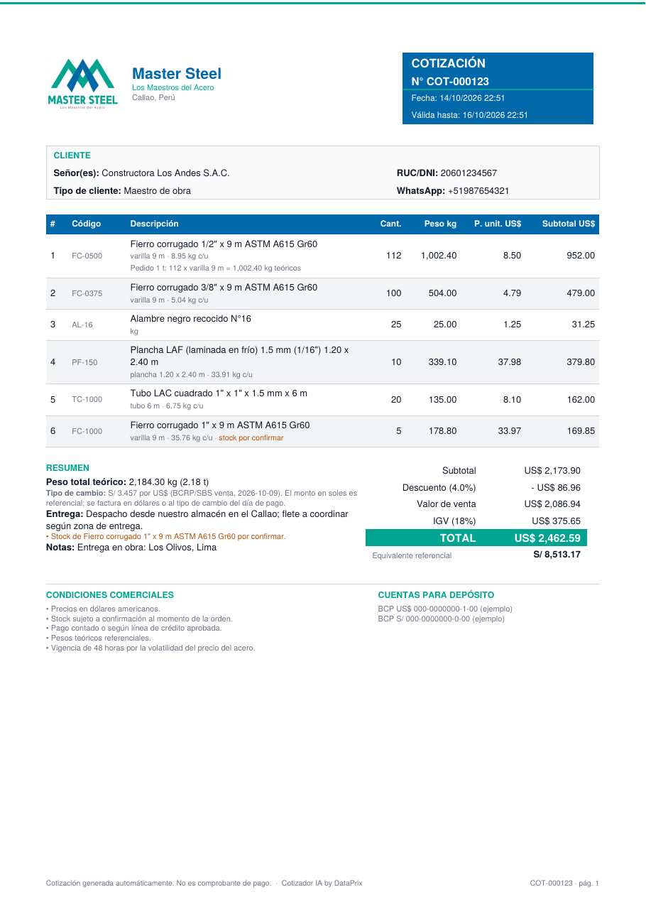
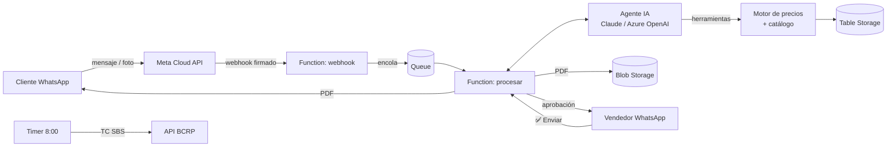

# Cotizador IA por WhatsApp · Distribuidores de acero

MVP de **DataPrix** · primer cliente: **Master Steel** (Callao) — *Los Maestros del Acero*. Un agente de IA atiende por WhatsApp a maestros de obra, ferreterías y empresas. Entiende la jerga del rubro ("fierro de media", "plancha negra de 1/8", "un ciento de tres octavos", "una tonelada de 5/8"). Arma la cotización en **dólares** con IGV y su equivalente en soles, y entrega un **PDF profesional** con número correlativo. Por defecto, el vendedor lo aprueba con un botón antes de que llegue al cliente.

> Principio de diseño: **la IA interpreta, el código calcula.** Ningún precio, peso, descuento ni tipo de cambio sale del modelo de lenguaje: todo viene de la lista de precios y de un motor determinístico probado.



## Qué resuelve

| Antes (manual) | Con el cotizador |
|---|---|
| 15–30 min por cotización: buscar precio, calcular pesos, tipo de cambio, armar Excel o Word | Menos de 2 min, 24/7, en el mismo WhatsApp |
| Jerga mal interpretada ("plancha negra" ¿LAF o LAC?) | Glosario y sinónimos por producto; si falta el espesor, el agente lo pregunta |
| Pedidos en kilos o toneladas que hay que convertir a varillas | Conversión automática con pesos teóricos (1 t de 1/2" = 112 varillas) |
| Cero data comercial | Registro de cada cotización, estado (ganada/perdida/motivo) y exportación a Excel o Power BI |

## Cómo funciona



1. El cliente escribe (texto, foto de su lista o audio, si se activa la transcripción).
2. El webhook valida la firma de Meta, guarda el mensaje y lo encola. Si el cliente manda varios mensajes seguidos ("hola", "quiero fierro", "de media", "100"), se agrupan y se responden juntos. Así se ahorran llamadas a la IA y mensajes cobrados por Meta.
3. El agente entiende el pedido, pregunta solo lo que falta y usa sus herramientas: `buscar_productos`, `calcular_cotizacion`, `generar_cotizacion` y `derivar_a_asesor`.
4. Se genera el PDF. En modo **aprobación**, el vendedor lo recibe con los botones **✅ Enviar** y **🙋 La atiendo yo**. En modo **automático**, el PDF va directo al cliente.
5. Si el vendedor responde desde la app WhatsApp Business (coexistencia) o el cliente pide un asesor, el bot se pausa con ese cliente.

## Estructura

```
function_app.py          Entradas de Azure Functions (webhook, cola, timer, admin)
cotizador/
  servicio.py            Orquestador + herramientas del agente + comandos de administrador
  agente.py              Bucle del agente y manejo del historial
  llm.py                 Adaptadores Anthropic / Azure OpenAI / transcripción
  prompts.py             Instrucciones del vendedor virtual y glosario de jerga
  precios.py             Motor de precios (Decimal, IGV, descuentos, conversiones)
  catalogo.py            Lista de precios: carga, validación y búsqueda tolerante a jerga
  texto.py               Normalización ("de media" -> 1/2, "tres octavos" -> 3/8...)
  tipo_cambio.py         TC SBS venta desde la API del BCRP (+ manual por WhatsApp)
  pdf.py                 PDF de la cotización
  whatsapp.py            Cloud API: firma, parseo, envío de texto/botones/PDF
  almacenamiento.py      Table/Blob/Queue de Azure + equivalentes en memoria
data/
  catalogo_ejemplo.csv            53 productos de acero con pesos teóricos (precios ficticios)
  plantilla_lista_precios.xlsx    Plantilla que llena el cliente
infra/                   Bicep (Flex Consumption + Storage + identidad) y deploy.sh
scripts/                 Simulador de chat, PDF demo, carga de catálogo, plantilla Excel
tests/                   76 pruebas (unitarias, flujo completo, robustez e integración con Azurite)
docs/                    Arquitectura, WhatsApp/Meta, despliegue y operación
```

## Arranque rápido (local)

```bash
python -m venv .venv && source .venv/bin/activate
pip install -r requirements-dev.txt

python -m pytest -q                        # pruebas
python scripts/generar_pdf_demo.py         # PDF de ejemplo, sin claves
export ANTHROPIC_API_KEY=sk-ant-...        # o LLM_PROVEEDOR=azure_openai + AZURE_OPENAI_*
python scripts/simular_chat.py             # conversar con el agente en la terminal
```

En el simulador puedes escribir como cliente ("hola, cuánto está el fierro de media?"), mandar una foto con `/foto lista.jpg`, actuar como vendedor con `/admin /pendientes` y aprobar con `/aprobar COT-000001`.

## Despliegue

1. **Azure:** copiar `infra/.env.example` a `infra/.env` y completarlo. Luego, en Windows: `powershell -ExecutionPolicy Bypass -File infra\deploy.ps1 -Region eastus`; en macOS/Linux: `./infra/deploy.sh rg-cotizador-acero eastus`. Ver [docs/despliegue_azure.md](docs/despliegue_azure.md).
2. **WhatsApp (Meta):** crear la app, obtener el token permanente y registrar el webhook. Ver [docs/configurar_whatsapp.md](docs/configurar_whatsapp.md).
3. **Lista de precios:** completar `data/plantilla_lista_precios.xlsx` y subirla con `scripts/cargar_catalogo.py`.
4. **CI/CD:** cada push a `main` corre las pruebas y despliega con GitHub Actions (OIDC, sin contraseñas).

## Configuración principal

| Variable | Para qué | Ejemplo |
|---|---|---|
| `MODO_ENVIO` | `aprobacion` (el vendedor revisa) o `automatico` | `aprobacion` |
| `ADMIN_NUMEROS` | WhatsApp de vendedores/administradores | `51999888777` |
| `LLM_PROVEEDOR` / `LLM_MODELO` | `anthropic` (Claude), `gemini` (capa gratuita para pruebas), `deepseek`, `azure_openai` u `openai_compatible` | `claude-haiku-5-5` |
| `LLM_MODELO_RESPALDO` | Modelo alterno si el principal está saturado (Gemini: `gemini-3.5-flash-lite` por defecto) | `ninguno` lo desactiva |
| `DESCUENTOS_TIPO_CLIENTE` | % por tipo de cliente | `maestro:0.02,ferreteria:0.05` |
| `DESCUENTOS_VOLUMEN_KG` | % por peso total del pedido | `1000:0.02,5000:0.04` |
| `DESCUENTO_MAXIMO` | Tope para proteger el margen | `0.08` |
| `VIGENCIA_HORAS` | Vigencia de la cotización | `48` |
| `TC_FUENTE` / `TC_SPREAD` | `bcrp` o `manual`; margen sobre el TC | `bcrp` / `0.02` |
| `PRECIOS_INCLUYEN_IGV` | Si la lista viene con IGV | `false` |
| `PREFIJO_TABLAS` | Varios clientes en una misma cuenta de Storage | `acerosx` |

La lista completa está en [infra/.env.example](infra/.env.example).

## Comandos del vendedor (por WhatsApp)

`/pendientes` · `/cot COT-000123` · `/ganada COT-000123` · `/perdida COT-000123 precio` · `/tc` · `/tc 3.75` · `/precio FC-0500 8.90` · `/stock FC-0500 agotado` · `/buscar plancha 1/8` · `/humano 519…` · `/bot 519…` · `/resumen 7`

## Costos de operación estimados (MYPE, ~10 cotizaciones/día)

| Componente | Estimado mensual |
|---|---|
| Azure Functions Flex Consumption + Storage + monitoreo | US$ 1–10 |
| IA (Claude Haiku con caché de prompt) | US$ 5–20 |
| WhatsApp Cloud API (Perú) | 1,000 respuestas gratis por número; luego ~S/ 0.10 por mensaje |

Son valores referenciales; dependen del volumen y de las tarifas vigentes de cada proveedor.

## Robustez

- **Un turno a la vez por cliente:** un candado por número, con vencimiento automático, evita respuestas duplicadas si el cliente escribe mientras el agente piensa.
- **Ningún mensaje se pierde:** se marca como recibido solo después de encolarlo; si algo falla, Meta reintenta.
- **Sin cotizaciones duplicadas:** si la cola reintenta un turno, `generar_cotizacion` es idempotente.
- **Ventana de 24 h de WhatsApp:** se registra el último mensaje de cada número. Si la ventana del vendedor está cerrada, se usa la plantilla. Si la del cliente venció, el sistema avisa al vendedor en lugar de fallar en silencio.
- **Las pausas del vendedor se respetan** aunque ocurran a mitad de un turno, porque el modo bot/humano se guarda aparte.

## Seguridad

- Firma `X-Hub-Signature-256` validada en cada webhook; sin `WA_APP_SECRET` se rechaza todo. Los mensajes duplicados se descartan.
- El CSV exportado neutraliza fórmulas (`=`, `+`, `-`, `@`) para evitar inyección al abrirlo en Excel.
- Storage sin claves compartidas: acceso por identidad administrada con roles mínimos.
- Los secretos van como parámetros `@secure` (recomendado para producción: moverlos a Key Vault).
- Endpoints de administración protegidos con clave de función.
- El agente solo atiende temas de acero y cotizaciones, y deriva a un humano los temas sensibles: crédito, reclamos y precios especiales.

## Hoja de ruta

| Fase | Entregable |
|---|---|
| MVP (este repo) | Agente + cotización PDF en USD + aprobación + KPIs básicos |
| Fase 2 | Dashboard Power BI (embudo, tasa de cierre, precio perdido por producto), seguimiento automático de cotizaciones por vencer (plantilla), lectura de listas en Excel |
| Fase 3 | Integración con ERP o facturación (stock real), catálogo web con cotizador, campañas de reactivación de clientes dormidos |
| SaaS | Multi-cliente (`PREFIJO_TABLAS`), panel de configuración, plan mensual por número |

---
© DataPrix · Cotizador IA para distribuidores de materiales de construcción.
