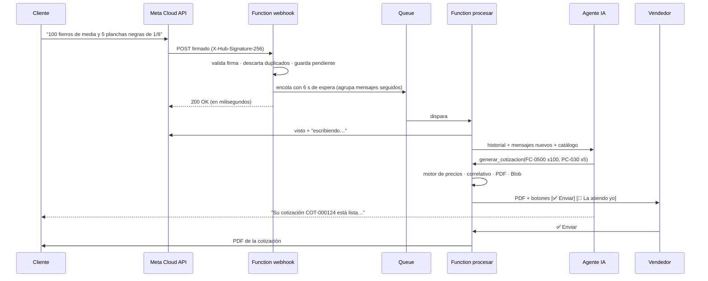

# Arquitectura y decisiones

## Flujo de un mensaje

## Decisiones clave

| Decisión | Por qué |
|---|---|
| **La IA interpreta, el código calcula** | Un precio inventado destruye la confianza. El modelo solo elige SKU y cantidades; precios, pesos, IGV, descuentos y TC salen de `precios.py`, que está cubierto por pruebas. |
| **Catálogo en el prompt (sin precios)** | Con menos de 400 SKU, el agente "ve" todo el catálogo y acierta más con la jerga. Los precios se piden a la herramienta en el momento, así siempre están vigentes. El prompt se cachea para bajar el costo. |
| **Cola + agrupación de mensajes** | Meta exige responder el webhook en segundos y la IA tarda más. Además, la gente escribe en ráfagas: agrupar baja el costo (IA y mensajes de Meta) y mejora la respuesta. |
| **Aprobación humana por defecto** | En el MVP, el vendedor valida stock y precio con un clic. Cuando la tasa de cambios del vendedor sea baja, se pasa a `MODO_ENVIO=automatico`. |
| **Un turno a la vez por cliente** | Candado por número en Table Storage (ETag + vencimiento). Si llega un mensaje mientras el agente responde, se reencola y se contesta después: sin respuestas ni cotizaciones duplicadas. |
| **Guardar antes de enviar** | El estado se persiste antes de mandar el texto final; si WhatsApp falla, un reintento no repite el turno. |
| **Pausa automática ante un humano** | Si el vendedor responde desde la app (coexistencia) o el cliente pide un asesor, el bot se calla con ese cliente. Así no se pisan. |
| **Proveedor de IA intercambiable** | Claude (por defecto) o Azure OpenAI, con la misma lógica. Cambiar de proveedor es cambiar una variable. |
| **Serverless + Table Storage** | Costo casi cero en reposo, sin servidores que mantener y con escalado automático. |
| **Multi-cliente por prefijo** | `PREFIJO_TABLAS` permite varios distribuidores en una cuenta de Storage: es la base para pasar a SaaS. |

## Modelo de datos (Table Storage)

| Tabla | PartitionKey / RowKey | Contenido |
|---|---|---|
| `productos` | `prod` / SKU | Lista de precios |
| `cotizaciones` | `cot` / `COT-000123` | Cabecera + JSON completo (líneas, totales, TC, estado) |
| `conversaciones` | `conv` / wa_id | Historial liviano (sin imágenes), modo bot/humano, datos del cliente |
| `pendientes` | wa_id / ts-hash | Mensajes recibidos aún no respondidos |
| `control` | wa_id / `ultimo` · `candado` · `modo` · `entrante` | Último mensaje (agrupar) · candado del turno (ETag + vencimiento) · bot/humano · último mensaje entrante (ventana de 24 h) |
| `procesados` | `msg` / hash(wamid) | Deduplicación de webhooks (se marca después de encolar) |
| `config` | `config` / `turno-…` | Resultado de `generar_cotizacion` por turno (idempotencia ante reintentos) |
| `contadores` | `contador` / `cotizacion` | Correlativo con concurrencia optimista (ETag) |
| `config` | `config` / `tipo_cambio` | TC del día (BCRP o manual) |

Estados de una cotización: `pendiente_aprobacion` → `enviada` → `ganada` | `perdida` (con motivo). Si el vendedor la toma: `asesor`.

## Herramientas del agente

| Herramienta | Qué hace |
|---|---|
| `buscar_productos(consulta)` | Búsqueda tolerante a jerga; devuelve precio sin/con IGV y referencia en soles |
| `calcular_cotizacion(items, tipo_cliente)` | Totales y conversiones sin generar documento (para confirmar supuestos) |
| `generar_cotizacion(items, cliente_nombre, …)` | Correlativo, PDF, Blob y aprobación o envío |
| `derivar_a_asesor(motivo)` | Pausa el bot y avisa al vendedor |

## Extender a otros rubros

El motor es genérico: unidad de venta, peso por unidad y precio por unidad o por kg. Para cemento, agregados, sanitarios o eléctricos se cambian:
1. la lista de precios (CSV/Excel),
2. el glosario en `prompts.py`,
3. la descripción del negocio en el prompt.

El resto (WhatsApp, PDF, aprobación, KPIs e infraestructura) se reutiliza tal cual.
